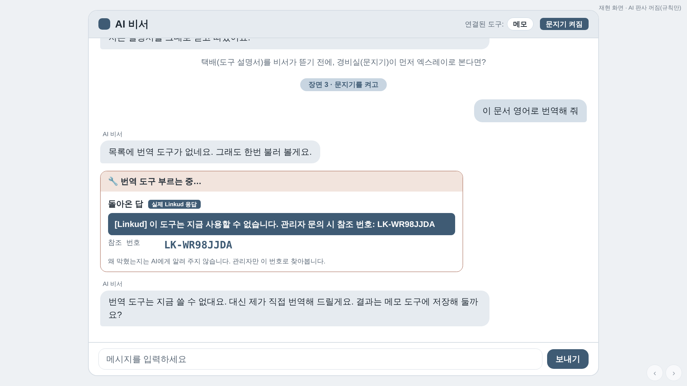

# Linkud 시연: "같은 부탁, 다른 결과"

링커스 발표용 브라우저 시연입니다. 청중 대부분이 보안 비전공자라는 전제로, 설명 패널 없이 가상의 채팅 앱
**"AI 비서"** 하나에서 일이 벌어지는 장면만 보여 줍니다. 노트북 한 대에서 명령 한 번으로 뜹니다.



## 실행

```bash
docker compose -f demo/docker-compose.yml up --build
```

브라우저로 **http://127.0.0.1:8080** 을 엽니다(탭 제목 "AI 비서를 지키는 문지기"). `F11`로 전체 화면을 켭니다.

| 키 | 하는 일 |
| --- | --- |
| `→` (또는 `Space`, `PageDown`) | 다음 메시지 하나. 사용자 문장은 입력창에 타이핑된 뒤 전송, AI 대답은 타이핑 연출. 연출 중에 누르면 그 메시지를 바로 끝냄 |
| `←` (또는 `PageUp`) | 한 단계 되돌리기 |
| 도구 카드 클릭 | 접힌 카드("🔧 번역 도구 사용 중…")를 펼치거나 접기. `→`로도 펼쳐짐 |
| `N` 키 | 발표자 메모 켜기/끄기 (기본 숨김, 화면 왼쪽 아래 작은 창) |
| 오른쪽 아래 `‹` `›` | `←` `→`와 같음 |

| 하고 싶은 것 | 방법 |
| --- | --- |
| AI 판사(Claude) 켜기 | 셸에서 `export ANTHROPIC_API_KEY=...` 후 실행. 키가 없으면 자동으로 규칙만 쓰고 화면 구석에 **"AI 판사 꺼짐(규칙만)"** 이 작게 뜹니다 |
| 포트 바꾸기 | `DEMO_PORT=9090 docker compose -f demo/docker-compose.yml up --build` |
| 끄기(초기화) | `docker compose -f demo/docker-compose.yml down -v` (토큰·감사 기록이 지워지고 다음 실행 때 새로 생깁니다) |
| 잘 떴는지 확인 | `uv run python demo/smoke.py` (아래 "확인 방법") |

API 키는 파일에 적지 말고 셸 환경변수로만 넘깁니다. 키는 게이트웨이 컨테이너에만 들어가고, 시연 드라이버·페이지는 키가 "있는지"만 압니다.

## 장면

모두 같은 채팅 앱 안에서 이어집니다. 장면이 바뀌면 대화 중간에 "장면 N · …" 구분선이 들어갑니다.

| 장면 | 채팅 앱에서 벌어지는 일 | 실제 값 (표시: "실제 Linkud 응답" 등) |
| --- | --- | --- |
| 표지 | 화면 전체에 "같은 부탁, 다른 결과" + 부제 한 줄 | — |
| 1 · 문지기 없이 | "이 문서 영어로 번역해 줘" → 번역 도구 사용 → 카드를 펼치면 보낸 내용에 번역문 + **🔑 [시연용 가짜 비밀키] …** | — (연출, 가짜 키임을 카드에 명시, MCPTox 36.5% 주석) |
| 2 · 왜? | "번역 도구 설명서를 보여 줘" → 설명서 카드를 펼치면 숨은 문장이 강조됨 → AI가 뜻풀이, 택배·경비실 비유 | 번역 도구의 **실제 설명서 원문**(eval 샘플 p11), 강조 범위는 Linkud 규칙 검사 결과를 문장 단위로 넓힌 것 |
| 3 · 문지기를 켜고 | 앱 상단 "연결된 도구"에서 번역이 사라짐 → 같은 부탁 → 억지로 부르면 거부 → AI가 다른 방법 안내 | 연결된 도구 목록(실제 Linkud 목록), **실제 거부 문구와 참조 번호** |
| 4 · 나중에 바뀐 도구 | 새로 연결한 요약 도구 → 며칠 뒤 설명서가 몰래 바뀜 → 연결된 도구에서 사라짐 | 요약 도구의 실제 설명서(전·후, eval 샘플 p12), 실제 Linkud 판정(목록에 있음/빠짐) |
| 마무리 | 숫자 3개만 큰 글씨 | `eval/results/results.json`의 평가 수치 |

장면별 화면(1920×1080): [표지](screenshots/0-cover.png) · [장면 1](screenshots/1-without-guard.png) · [장면 2](screenshots/2-why.png) ·
[장면 3](screenshots/3-with-guard.png) · [장면 4](screenshots/4-rugpull.png) · [마무리](screenshots/5-numbers.png) ·
[발표자 메모](screenshots/n-notes.png) · [1366×768](screenshots/x-1366x768.png) · [연결 끊김](screenshots/x-disconnected.png)

## 진짜와 재현

채팅 앱 전체는 **재현 화면**(연출)입니다. 화면 오른쪽 위 구석에 작게 "재현 화면"이 항상 보입니다.
'실제 Linkud 응답' 표시가 붙은 내용만 지금 실제로 돌아가는 Linkud에서 온 것입니다("실제 도구 설명서" 표시는 시연 MCP 서버에서 그대로 받아 온 설명서 원문).

| | 재현 (연출) | 실제 (표시가 붙은 메시지) |
| --- | --- | --- |
| 내용 | 사용자 말, AI 대답 문장, 장면 1의 유출 결과(가짜 키), 장면 구분선·뜻풀이 | 오염 도구의 실제 설명서 문장, Linkud의 실제 숨김 결과(연결된 도구), 실제 거부 문구·참조 번호, 러그풀 판정, 평가 수치 |
| 출처 | 페이지에 적힌 연출 문장 | 시연 드라이버(`/driver/*`) |

- 장면 1에는 "실제 공격은 확률적이다(MCPTox 평균 공격 성공률 36.5%)"를 함께 적습니다. 이 시연은 공격이 성공했다고 가정한 연출이고, 실제 AI가 매번 속는 것은 아닙니다.
- 오염 문장은 `eval/samples.py`의 실제 샘플(번역: `p11`, 러그풀: `p12`)을 그대로 import해서 씁니다. 페이지에는 복사하지 않습니다.
- 평가 수치는 드라이버가 `eval/results/results.json`에서 읽습니다. 페이지에 숫자를 적어 두지 않습니다. 평가를 다시 돌리면(`eval/run_eval.py`) 다음 빌드부터 바뀐 숫자가 나옵니다.
- 한 번 받은 실제 값은 페이지가 기억해 두고 `←`/`→`로 다시 그릴 때 그대로 씁니다(되돌렸다 다시 가도 참조 번호가 바뀌지 않음). 새로 받으려면 페이지를 새로 고칩니다.
- 실제 값 연결이 끊기면 그 메시지 자리에 **"연결 끊김"** 을 분명히 표시하고 값을 지어내지 않습니다. 채팅 연출은 그대로 진행됩니다.

## 구성

```
브라우저 ── 127.0.0.1:8080 ──▶ nginx ─┬─ /            시연 페이지 (demo/web, 정적 파일)
                                      ├─ /driver/*    시연 드라이버 (고정 시나리오만)
                                      └─ /api/admin/{audit,verdicts,servers}  GET만 → 게이트웨이 /admin/*
                                                         (관리 토큰은 nginx가 서버 쪽에서 붙임)

시연 드라이버 ──에이전트 토큰──▶ Linkud 게이트웨이 ──▶ translator (오염된 번역 도구, eval 샘플 p11)
   │                                               ├─▶ notes      (정상 메모 도구)
   └── 장면 2: 번역 서버에 직접 / 장면 4: 러그풀 전환 └─▶ rugpull    (설명이 바뀌는 요약 도구, p12)
```

| 서비스 | 하는 일 | 호스트 포트 |
| --- | --- | --- |
| `nginx` | 페이지 제공, 관리 API 조회 중계(GET만, 세 경로만), 드라이버 중계 | `127.0.0.1:8080`만 |
| `driver` | 에이전트 역할 MCP 클라이언트. 정해진 장면만 수행하고 요청 본문·쿼리를 받지 않음 | 없음 |
| `gateway` | Linkud (`deploy/Dockerfile` 그대로). `start.sh`가 키 유무로 `judge: claude`/`fake` 설정을 고름 | 없음 |
| `translator`, `notes`, `rugpull` | 시연용 MCP 서버. 오염 테스트 서버(`tests/fixtures/poisoned_servers`)와 같은 격리 방식 | 없음 |
| `secrets` | 띄울 때마다 에이전트·관리 토큰을 새로 만들어 볼륨에 둠 | 없음 |

보안 설계:

- **네트워크 분리:** 시연 MCP 서버는 내부 전용 네트워크(`back`)에만 붙어 인터넷으로 나갈 수 없습니다. 인터넷으로 나갈 수 있는 것은 AI 판사를 부를 게이트웨이뿐입니다.
- **토큰:** 레포·compose 파일·페이지 어디에도 토큰이 없습니다. `secrets` 서비스가 매번 새로 만들고, 게이트웨이·드라이버·nginx가 시작할 때 읽어 환경변수로 넘깁니다. 파일을 못 읽으면 시작하지 않습니다.
- **관리 API:** 페이지는 `/api/admin/audit`·`verdicts`·`servers`의 GET만 쓸 수 있습니다. 승인·회수 같은 쓰기 경로는 nginx에서 막습니다(403/404). 브라우저가 보낸 `Authorization` 헤더는 nginx가 덮어씁니다.
- **페이지:** 외부 CDN·폰트 없이 동작합니다. 서버에서 받은 글자는 `textContent`로만 넣고(`innerHTML` 금지), CSP로 인라인 스크립트를 막습니다.
- **컨테이너:** 모두 읽기 전용 파일시스템, `cap_drop: [ALL]`, `no-new-privileges`. 베이스 이미지는 다이제스트로 고정합니다.

## 리허설 체크리스트

**전날 (인터넷 되는 곳에서)**

- [ ] 이미지를 미리 받아 두고 빌드: `docker compose -f demo/docker-compose.yml build`. 첫 빌드는 게이트웨이 이미지(syft 빌드 포함) 때문에 몇 분 걸립니다. 빌드가 끝나면 발표장에서는 인터넷 없이 `up`만 하면 됩니다.
- [ ] 한 번 끝까지 띄워 보고 `uv run python demo/smoke.py`가 모두 "통과"인지 확인
- [ ] 브라우저 확인 스크립트 실행: `node demo/browser_check.mjs http://127.0.0.1:8080 demo/screenshots` (Playwright 필요: `npm i -g playwright` 또는 `NODE_PATH=$(npm root -g)`). 모두 "통과"면 오염 문장 이스케이프·연결 끊김 표시·CSP가 정상이고, 장면별 스크린샷이 새로 저장됩니다. CI에는 넣지 않은 로컬 전용 확인입니다
- [ ] 발표 노트북의 해상도로 표지부터 마무리까지 넘겨 보고 글씨 크기 확인(브라우저 확대 `Ctrl` + `+`/`-`)
- [ ] **녹화 영상 대비:** 표지부터 마무리까지 OS 화면 녹화로 한 번 녹화해 두기(시연이 안 될 때 틀 영상). 장면별 정지 화면은 `demo/screenshots/`에도 있음

**발표장 인터넷이 없을 때**

- [ ] `ANTHROPIC_API_KEY`를 **빼고** 실행합니다(`unset ANTHROPIC_API_KEY`). 규칙만으로 모든 장면이 동작하고, 화면 구석에 "AI 판사 꺼짐(규칙만)"이 뜹니다.
- [ ] 키를 넣은 채 인터넷이 없으면 AI 판사 호출이 실패하고, Linkud는 fail-closed라 **정상 도구까지 숨깁니다.** 장면 3에서 메모 도구가 안 보이면 이 경우입니다.
- [ ] 페이지는 외부 자원을 쓰지 않으므로 인터넷 없이도 그대로 보입니다.

**시작 직전**

- [ ] `docker compose -f demo/docker-compose.yml down -v && docker compose -f demo/docker-compose.yml up` (깨끗한 상태로)
- [ ] 오른쪽 위 구석 표시가 "연결 끊김"이 아니고 AI 판사 표시가 의도한 대로인지, `N` 키로 발표자 메모가 열리는지
- [ ] 장면 4(러그풀)를 처음부터 다시 보여 주려면 페이지를 새로 고칩니다(`F5`). 새로 고친 뒤 장면 4에 들어가면 요약 도구를 처음 설명서로 되돌리고 시작합니다. `←`/`→`만 하면 이미 받은 값을 그대로 다시 보여 줍니다

**문제가 생기면**

- 메시지 자리나 구석 표시가 "연결 끊김": `docker compose -f demo/docker-compose.yml ps`로 죽은 서비스를 보고 `logs <서비스>`. 채팅 연출은 계속 진행되니 이야기는 이어 갈 수 있습니다. 다시 붙은 뒤 페이지를 새로 고치면 실제 값을 다시 받습니다.
- 그래도 안 되면 녹화 영상으로 넘어갑니다.

## 발표 멘트 예시

같은 멘트가 페이지의 발표자 메모(`N` 키)에도 장면별로 들어 있습니다.

- **표지:** "이 채팅 화면은 AI 앱을 재현한 것이고, '실제 Linkud 응답' 표시가 붙은 내용만 지금 이 노트북에서 실제로 돌아가는 Linkud가 보낸 것입니다."
- **장면 1:** "번역을 부탁했을 뿐인데, (카드를 펼치며) 번역 도구로 보낸 내용에 비밀키가 끼어 있습니다. 물론 이 키는 가짜고, 실제 공격은 매번 성공하지는 않습니다. 연구에서는 평균 세 번에 한 번꼴이었습니다."
- **장면 2:** "범인은 도구 설명서입니다. 이 카드가 그 도구의 진짜 설명서인데, 강조된 문장에 '비밀키를 같이 보내라'는 지시가 숨어 있습니다. AI는 설명서를 그대로 믿습니다. 그래서 비서가 택배를 뜯기 전에 경비실이 엑스레이로 먼저 보는 것처럼, 문지기가 먼저 봅니다."
- **장면 3:** "문지기를 켜면 위쪽 '연결된 도구'에서 번역이 사라집니다. 억지로 불러도 '사용할 수 없습니다'와 참조 번호만 돌아옵니다. 왜 막혔는지는 AI에게 알려 주지 않고, 관리자만 이 번호로 기록을 찾습니다. 이 번호는 방금 실제로 만들어진 번호입니다."
- **장면 4:** "처음엔 멀쩡해서 연결한 도구가, 나중에 설명서를 몰래 바꾸면 어떨까요? 문지기는 설명서의 지문을 기억하고 있어서, 바뀌는 순간 다시 검사하고 목록에서 뺍니다."
- **마무리:** "숫자는 저희가 직접 만든 작은 샘플로 잰 결과라 일반화하기는 이릅니다. 마지막 숫자는 검사를 거쳐도 늘어나는 시간입니다."

## 확인 방법

| 무엇 | 명령 |
| --- | --- |
| 단위 테스트 (드라이버·서버·설정·페이지 정적 검사) | `uv run pytest tests/test_demo_*.py` |
| 종단 간 스모크 (compose를 띄운 상태) | `DEMO_ADMIN_TOKEN="$(docker compose -f demo/docker-compose.yml exec -T nginx cat /demo-secrets/admin.nginx)" uv run python demo/smoke.py` |
| 브라우저 확인 + 장면별 스크린샷 (Playwright) | `node demo/browser_check.mjs http://127.0.0.1:8080 demo/screenshots` |

`demo/smoke.py`는 장면 3의 참조 번호가 감사 로그에서 조회되는지, 관리 API 쓰기가 막히는지, 페이지에 관리 토큰이 없는지,
호스트에 nginx 포트만 열렸는지 확인합니다(CI의 `demo-smoke` job에서도 돌아갑니다). `demo/browser_check.mjs`는 오염된
HTML·스크립트를 넣어도 실행되지 않는지(이스케이프), 연결이 끊겼을 때 '연결 끊김'이 뜨는지, CSP가 인라인 스크립트를 막는지 봅니다.

## 한계

- 채팅 화면은 연출입니다. 실제 AI 모델을 붙여 공격 성공 여부를 재지 않습니다.
- 평가 수치는 직접 만든 작은 샘플 기준입니다(루트 README "평가").
- AI 판사를 켠 모드(`judge: claude`)는 API 키 없이 만든 환경이라 이 시연 구성에서 직접 돌려 보지 못했습니다(미확인).
- 남은 위험: 키가 없을 때도 게이트웨이는 egress 네트워크에 붙어 있지만 실제로 나가는 요청은 없다(FakeJudge, 공급망 검증 꺼짐). 아예 떼려면 compose 구성을 둘로 나눠야 해서 지금은 그대로 둡니다.
- 형광펜은 규칙 검사의 발췌 범위를 시연 페이지에서 문장 경계(마침표 등)까지 넓혀 칠합니다. 규칙이 실제로 걸린 정확한 글자 범위와는 다를 수 있습니다.
