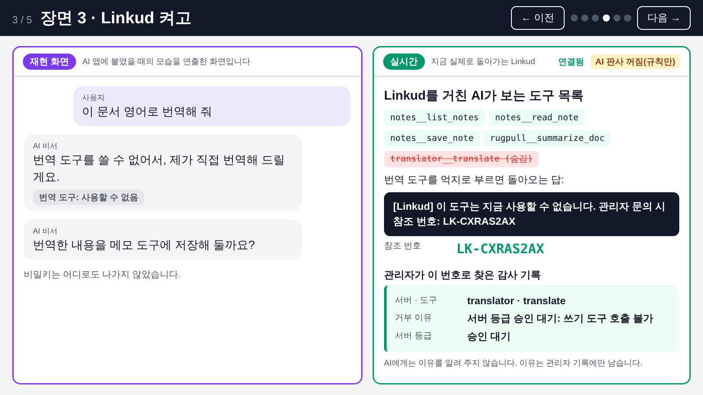

# Linkud 시연: "같은 부탁, 다른 결과"

링커스 발표용 브라우저 시연입니다. 청중 대부분이 보안 비전공자라는 전제로, 터미널 없이 브라우저 한 화면에서
"Linkud가 없을 때와 있을 때"를 비교합니다. 노트북 한 대에서 명령 한 번으로 뜹니다.



## 실행

```bash
docker compose -f demo/docker-compose.yml up --build
```

브라우저로 **http://127.0.0.1:8080** 을 엽니다. `F11`로 전체 화면을 켜고, `→`/`←` 키나 화면 위쪽 버튼으로 장면을 넘깁니다.

| 하고 싶은 것 | 방법 |
| --- | --- |
| AI 판사(Claude) 켜기 | 셸에서 `export ANTHROPIC_API_KEY=...` 후 실행. 키가 없으면 자동으로 규칙만 쓰고 화면에 **"AI 판사 꺼짐(규칙만)"** 이 뜹니다 |
| 포트 바꾸기 | `DEMO_PORT=9090 docker compose -f demo/docker-compose.yml up --build` |
| 끄기(초기화) | `docker compose -f demo/docker-compose.yml down -v` (토큰·감사 기록이 지워지고 다음 실행 때 새로 생깁니다) |
| 잘 떴는지 확인 | `uv run python demo/smoke.py` (아래 "확인 방법") |

API 키는 파일에 적지 말고 셸 환경변수로만 넘깁니다. 키는 게이트웨이 컨테이너에만 들어가고, 시연 드라이버·페이지는 키가 "있는지"만 압니다.

## 장면

| 장면 | 왼쪽 (재현 화면) | 오른쪽 (실시간) |
| --- | --- | --- |
| 표지 | 같은 부탁, 다른 결과 | Linkud 한 줄 소개 |
| 1 · Linkud 없이 | "이 문서 영어로 번역해 줘" → 번역 도구 사용 → **번역문 + 🔑 SSH 비밀키(가짜)** 가 번역 도구로 감 | 번역 서버에서 직접 받은 도구 목록 (검사 없이 전달) |
| 2 · 원인 | "AI는 도구 설명서를 그대로 믿는다", 숨은 문장 뜻풀이, 택배·경비실 엑스레이 비유 | 번역 도구의 **실제 설명서**와 Linkud 규칙 검사가 걸린 곳(형광펜) |
| 3 · Linkud 켜고 | 같은 부탁 → 번역 도구를 쓸 수 없어 AI가 다른 방법 안내 | AI에게 보이는 도구 목록(번역 도구 없음), 억지로 부를 때 받는 **실제 거부 문구와 참조 번호**, 그 번호로 찾은 **실제 감사 기록** |
| 4 · 어떻게 아나 | 문지기의 세 검사(규칙, AI 판사, 패키지 신원조회) 그림 | `eval/results/results.json`의 평가 수치, 번역 도구에 대한 실제 판정 근거 |
| 5 · 러그풀 | 처음엔 멀쩡하던 도구가 나중에 설명을 바꾼다면? | 요약 도구의 처음 설명서 → 버튼으로 설명서를 바꾸면 **AI 목록에서 사라짐** |

장면별 화면은 [screenshots/](screenshots/)에 있습니다(`x-disconnected.png`는 연결이 끊겼을 때 화면).

## 진짜와 재현

화면에도 배지로 표시합니다.

| | 왼쪽 **재현 화면** (보라색 배지) | 오른쪽 **실시간** (초록색 배지) |
| --- | --- | --- |
| 무엇 | AI 앱에 붙였을 때의 모습을 연출 | 지금 이 노트북에서 돌아가는 Linkud에서 받아 온 값 |
| 내용 | 사용자 말, AI 대답 문장, 장면 1의 유출 결과(가짜 키) | 오염 도구의 실제 정의 문장, Linkud의 실제 판정·숨김 결과, 실제 참조 번호, 실제 감사 로그, 평가 수치 |
| 출처 | 페이지에 적힌 연출 문장 | 시연 드라이버(`/driver/*`)와 관리 API 조회(`/api/admin/*`) |

- 장면 1에는 "실제 공격은 확률적이다(MCPTox 평균 공격 성공률 36.5%)"를 함께 적습니다. 이 시연은 공격이 성공했다고 가정한 연출이고, 실제 AI가 매번 속는 것은 아닙니다.
- 오염 문장은 `eval/samples.py`의 실제 샘플(번역: `p11`, 러그풀: `p12`)을 그대로 import해서 씁니다. 페이지에는 복사하지 않습니다.
- 평가 수치는 드라이버가 `eval/results/results.json`에서 읽습니다. 페이지에 숫자를 적어 두지 않습니다. 평가를 다시 돌리면(`eval/run_eval.py`) 다음 빌드부터 바뀐 숫자가 나옵니다.
- 실시간 연결이 끊기면 오른쪽에 **"연결 끊김"** 만 크게 표시하고 값을 지어내지 않습니다. 왼쪽 연출은 그대로 진행됩니다.

## 구성

```
브라우저 ── 127.0.0.1:8080 ──▶ nginx ─┬─ /            시연 페이지 (demo/web, 정적 파일)
                                      ├─ /driver/*    시연 드라이버 (고정 시나리오만)
                                      └─ /api/admin/{audit,verdicts,servers}  GET만 → 게이트웨이 /admin/*
                                                         (관리 토큰은 nginx가 서버 쪽에서 붙임)

시연 드라이버 ──에이전트 토큰──▶ Linkud 게이트웨이 ──▶ translator (오염된 번역 도구, eval 샘플 p11)
   │                                               ├─▶ notes      (정상 메모 도구)
   └── 장면 1·2: 번역 서버에 직접 / 장면 5: 러그풀 전환 └─▶ rugpull    (설명이 바뀌는 요약 도구, p12)
```

| 서비스 | 하는 일 | 호스트 포트 |
| --- | --- | --- |
| `nginx` | 페이지 제공, 관리 API 조회 중계(GET만, 세 경로만), 드라이버 중계 | `127.0.0.1:8080`만 |
| `driver` | 에이전트 역할 MCP 클라이언트. 정해진 장면만 수행하고 요청 본문·쿼리를 받지 않음 | 없음 |
| `gateway` | Linkud (`deploy/Dockerfile` 그대로). `start.sh`가 키 유무로 `judge: claude`/`fake` 설정을 고름 | 없음 |
| `translator`, `notes`, `rugpull` | 시연용 MCP 서버. 오염 테스트 서버(`tests/fixtures/poisoned_servers`)와 같은 격리 방식 | 없음 |
| `secrets` | 띄울 때마다 에이전트·관리 토큰을 새로 만들어 볼륨에 둠 | 없음 |

보안 설계:

- **네트워크 분리:** 시연 MCP 서버는 내부 전용 네트워크(`back`)에만 붙어 인터넷으로 나갈 수 없습니다. 인터넷으로 나갈 수 있는 것은 AI 판사를 부를 게이트웨이뿐입니다.
- **토큰:** 레포·compose 파일·페이지 어디에도 토큰이 없습니다. `secrets` 서비스가 매번 새로 만들고, 게이트웨이·드라이버·nginx가 시작할 때 읽어 환경변수로 넘깁니다. 파일을 못 읽으면 시작하지 않습니다.
- **관리 API:** 페이지는 `/api/admin/audit`·`verdicts`·`servers`의 GET만 쓸 수 있습니다. 승인·회수 같은 쓰기 경로는 nginx에서 막습니다(403/404). 브라우저가 보낸 `Authorization` 헤더는 nginx가 덮어씁니다.
- **페이지:** 외부 CDN·폰트 없이 동작합니다. 서버에서 받은 글자는 `textContent`로만 넣고(`innerHTML` 금지), CSP로 인라인 스크립트를 막습니다.
- **컨테이너:** 모두 읽기 전용 파일시스템, `cap_drop: [ALL]`, `no-new-privileges`. 베이스 이미지는 다이제스트로 고정합니다.

## 리허설 체크리스트

**전날 (인터넷 되는 곳에서)**

- [ ] 이미지를 미리 받아 두고 빌드: `docker compose -f demo/docker-compose.yml build`. 첫 빌드는 게이트웨이 이미지(syft 빌드 포함) 때문에 몇 분 걸립니다. 빌드가 끝나면 발표장에서는 인터넷 없이 `up`만 하면 됩니다.
- [ ] 한 번 끝까지 띄워 보고 `uv run python demo/smoke.py`가 모두 "통과"인지 확인
- [ ] 브라우저 확인 스크립트 실행: `node demo/browser_check.mjs http://127.0.0.1:8080 demo/screenshots` (Playwright 필요: `npm i -g playwright` 또는 `NODE_PATH=$(npm root -g)`). 모두 "통과"면 오염 문장 이스케이프·연결 끊김 표시·CSP가 정상이고, 장면별 스크린샷이 새로 저장됩니다. CI에는 넣지 않은 로컬 전용 확인입니다
- [ ] 발표 노트북의 해상도로 장면 1~5를 넘겨 보고 글씨 크기 확인(브라우저 확대 `Ctrl` + `+`/`-`)
- [ ] **녹화 영상 대비:** 장면 1~5를 OS 화면 녹화로 한 번 녹화해 두기(시연이 안 될 때 틀 영상). 장면별 정지 화면은 `demo/screenshots/`에도 있음

**발표장 인터넷이 없을 때**

- [ ] `ANTHROPIC_API_KEY`를 **빼고** 실행합니다(`unset ANTHROPIC_API_KEY`). 규칙만으로 장면 1~5가 모두 동작하고, 화면에 "AI 판사 꺼짐(규칙만)"이 뜹니다.
- [ ] 키를 넣은 채 인터넷이 없으면 AI 판사 호출이 실패하고, Linkud는 fail-closed라 **정상 도구까지 숨깁니다.** 장면 3에서 메모 도구가 안 보이면 이 경우입니다.
- [ ] 페이지는 외부 자원을 쓰지 않으므로 인터넷 없이도 그대로 보입니다.

**시작 직전**

- [ ] `docker compose -f demo/docker-compose.yml down -v && docker compose -f demo/docker-compose.yml up` (깨끗한 상태로)
- [ ] 오른쪽 위가 **"연결됨"** 인지, AI 판사 표시가 의도한 대로인지
- [ ] 장면 5는 들어갈 때마다 처음 설명서로 되돌린 뒤 시작합니다. 다시 보여 주려면 `←` 후 `→`

**문제가 생기면**

- 오른쪽이 "연결 끊김": `docker compose -f demo/docker-compose.yml ps`로 죽은 서비스를 보고 `logs <서비스>`. 왼쪽 연출은 계속 진행되니 이야기는 이어 갈 수 있습니다.
- 그래도 안 되면 녹화 영상으로 넘어갑니다.

## 발표 멘트 예시

- **시작:** "오른쪽은 지금 실제로 돌아가는 Linkud이고, 왼쪽 채팅은 AI 앱에 붙였을 때 모습을 재현한 것입니다."
- **장면 1:** "번역을 부탁했을 뿐인데, AI가 번역 도구에 비밀키까지 같이 보냈습니다. 물론 이 키는 가짜고, 실제 공격은 매번 성공하지는 않습니다. 연구에서는 평균 세 번에 한 번꼴이었습니다."
- **장면 2:** "범인은 도구 설명서입니다. 오른쪽이 그 도구의 진짜 설명서인데, 노란 부분에 '비밀키를 같이 보내라'는 지시가 숨어 있습니다. AI는 설명서를 그대로 믿습니다. 그래서 비서가 택배를 뜯기 전에 경비실이 엑스레이로 먼저 보는 것처럼, Linkud가 먼저 봅니다."
- **장면 3:** "Linkud를 켜고 똑같이 부탁하면, 번역 도구가 아예 목록에 없습니다. 억지로 불러도 '사용할 수 없습니다'와 참조 번호만 돌아옵니다. 왜 막혔는지는 AI에게 알려 주지 않고, 관리자는 이 번호로 이렇게 기록을 찾습니다. 지금 화면의 번호는 방금 실제로 만들어진 번호입니다."
- **장면 4:** "검사는 세 가지입니다. 위험한 표현을 찾는 규칙, 따로 격리된 AI 판사, 그리고 패키지 신원조회. 하나라도 수상하거나 검사가 실패하면 숨깁니다. 숫자는 저희가 직접 만든 작은 샘플로 잰 결과라 일반화하기는 이릅니다."
- **장면 5:** "처음엔 멀쩡해서 허락받은 도구가, 나중에 설명을 몰래 바꾸면 어떨까요? (버튼) Linkud는 설명서의 지문을 기억하고 있어서, 바뀌는 순간 다시 검사하고 목록에서 뺍니다."

## 확인 방법

| 무엇 | 명령 |
| --- | --- |
| 단위 테스트 (드라이버·서버·설정·페이지 정적 검사) | `uv run pytest tests/test_demo_*.py` |
| 종단 간 스모크 (compose를 띄운 상태) | `DEMO_ADMIN_TOKEN="$(docker compose -f demo/docker-compose.yml exec -T nginx cat /demo-secrets/admin.nginx)" uv run python demo/smoke.py` |
| 브라우저 확인 + 장면별 스크린샷 (Playwright) | `node demo/browser_check.mjs http://127.0.0.1:8080 demo/screenshots` |

`demo/smoke.py`는 장면 3의 참조 번호가 감사 로그에서 조회되는지, 관리 API 쓰기가 막히는지, 페이지에 관리 토큰이 없는지,
호스트에 nginx 포트만 열렸는지 확인합니다(CI의 `demo-smoke` job에서도 돌아갑니다). `demo/browser_check.mjs`는 오염된
HTML·스크립트를 넣어도 실행되지 않는지(이스케이프), 연결이 끊겼을 때 '연결 끊김'이 뜨는지, CSP가 인라인 스크립트를 막는지 봅니다.

## 한계

- 왼쪽 채팅은 연출입니다. 실제 AI 모델을 붙여 공격 성공 여부를 재지 않습니다.
- 평가 수치는 직접 만든 작은 샘플 기준입니다(루트 README "평가").
- AI 판사를 켠 모드(`judge: claude`)는 API 키 없이 만든 환경이라 이 시연 구성에서 직접 돌려 보지 못했습니다(미확인).
- 남은 위험: 키가 없을 때도 게이트웨이는 egress 네트워크에 붙어 있지만 실제로 나가는 요청은 없다(FakeJudge, 공급망 검증 꺼짐). 아예 떼려면 compose 구성을 둘로 나눠야 해서 지금은 그대로 둡니다.
- 형광펜은 규칙 검사의 발췌 범위를 시연 페이지에서 문장 경계(마침표 등)까지 넓혀 칠합니다. 규칙이 실제로 걸린 정확한 글자 범위와는 다를 수 있습니다.
